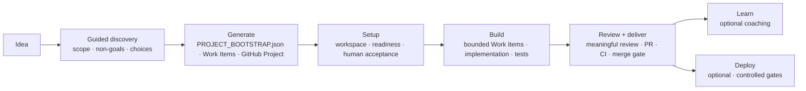
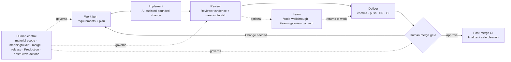

# Welcome to Project Forge

**Build real software. Learn the engineering behind it.**

## Project Forge at a glance



Project Forge is an AI-guided software development and learning platform for turning a personal software idea into a reproducible engineering project while keeping meaningful decisions under human control.

The goal is not just to generate source code. Project Forge creates an engineering operating model around the project: approved scope, explicit technology choices, deterministic generation, a self-contained VS Code workspace, setup/readiness checks, CI, delivery gates, optional learning, and controlled deployment boundaries.

A typical journey is:

```text
idea
→ Guided Project Discovery
→ V1 scope + non-goals
→ technology/testing/data/deployment choices
→ approved PROJECT_BOOTSTRAP.json + Work Items
→ deterministic GitHub Project repository generation
→ generated development workspace
→ setup + readiness + human workspace acceptance
→ bounded Work Items
→ implementation + tests
→ meaningful review + pull-request delivery
→ optional learning/coaching
→ optional deployment
```

Project Forge asks one material question at a time, recommends choices when useful, explains tradeoffs, and records the decisions you approve.

## AI handles mechanics; humans retain engineering authority



Project Forge standardizes high-frequency mechanics so you spend less time on ceremony, but it does not silently approve material requirements, meaningful implementation changes, merge/finalization, release publication, Production deployment, or destructive operations.

## Human control

Project Forge can assist with discovery, technology recommendations, generation, setup, implementation, testing, review, deployment mechanics, explanations, and coaching.

You remain the decision-maker for material scope, meaningful implementation/diff acceptance, PR merges, release publication, Production deployment, and destructive Production actions.

## Learning is optional

Useful learning tools include:

```text
/code-walkthrough
/learning-review
/coach
/wait-what
```

Learning is integrated but never blocks delivery. The preferred deeper-learning sequence is `/code-walkthrough <ID>` → `/learning-review <ID>` → targeted `/coach`; `/wait-what` is available for quick re-explanation.

## Your repositories and credentials stay yours

Each Builder owns their own Project repositories. Joining Project Forge does not grant another Builder access to your private Projects or grant you access to theirs.

Do not send another developer or ChatGPT your GitHub password, PAT, SSH private key, or other secrets. Automation uses scoped Project Forge Builder GitHub App access and Project/workstation-specific credential boundaries.

## What you need

A new Builder normally needs a GitHub account, an invitation from an active Project Forge admin, permission to install/approve **Project Forge Builder**, and a ChatGPT coding Project for the guided experience.

Developer tools are handled later by each generated Project's `/setup` workflow as needed.

## Activation

Your invitation guides you through:

```text
1. Install/approve Project Forge Builder.
2. In the same issue, comment exactly: /accept-project-forge
```

Opening the issue alone does not activate access. Successful onboarding ends with:

```text
READY FOR PROJECT FORGE
```

`/project-forge-doctor` is available only if readiness later needs to be retried.

## Configure ChatGPT once

Follow [`chatgpt/SETUP.md`](chatgpt/SETUP.md). Every Builder uses the same canonical Project Forge Project instruction; only the personal Developer Profile differs.

Then start with:

```text
New Project: <your idea>
```
