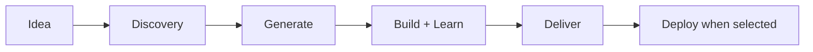
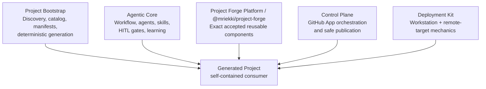
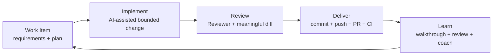
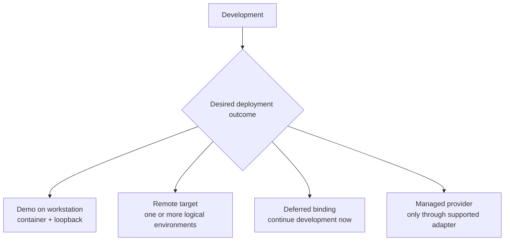

# Project Forge Platform — Engineering Guide

> This Markdown guide began as a repository-friendly conversion of the **Project Forge Platform | Integrated Briefing** prepared 16 October 2026. The platform has continued to evolve. Live repository evidence, accepted baselines, and current process docs outrank historical example/status statements when they differ.

## From Idea to Engineering Environment

**Core promise:** provide an easy way to turn a personal software idea into a reproducible, AI-enabled engineering project — with technology choice, streamlined setup, deliberate learning, real SDLC practices, and a deployment model that can scale from one-machine local use to distinct Staging / Production environments when the project actually needs them.



Technology choice + deterministic setup + Project Forge AI workflow + learning + CI + explicit deployment topology.

---

## 1. Purpose & Executive Thesis

### Make experimentation easy without making engineering disposable

The platform lowers the friction of starting a personal project while preserving enough professional engineering structure that the work is repeatable, teachable, and credible.

| Principle | Meaning |
| --- | --- |
| Low friction | Start from a short idea instead of hand-assembling repository conventions, setup scripts, AI instructions, and workflow boilerplate. |
| Choice | Select a technology direction based on project needs or learning goals, with explicit support-state signals rather than hidden assumptions. |
| Discipline | Use a Project Forge workflow with bounded implementation, review, CI evidence, and meaningful human acceptance points. |
| Learning | Build understanding alongside code through work-item guides, code walkthroughs, learning review, and targeted coaching. |
| Realism | Exercise containerization, source control, CI, releases, environment isolation, and deployment tradeoffs without pretending every Project needs dedicated Staging/Production computers. |
| Repeatability | Create self-contained generated repositories with explicit provenance and controlled platform updates. |

### Why this is different from “generate me an app”

The outcome is not just source code. It is a project with an engineering operating model: approved scope, stack decision, workspace conventions, AI behavior, work items, setup/readiness, CI, delivery gates, learning support, and deployment boundaries.

---

## 2. Value Stream

### One guided path from idea to a working engineering system

AI is used where conversation and judgment help; deterministic tooling is used where reproducibility and safety matter.

1. **Define** — conversational discovery turns a vague idea into users, workflows, state/lifecycle, success criteria, non-goals, security/privacy, and learning goals.
2. **Choose** — technology and deployment outcome/topology are selected against a live catalog and recipe model, with support maturity made visible.
3. **Generate** — a human-approved manifest drives deterministic generation of a self-contained repository and AI-ready workspace.
4. **Build** — work items flow through Project Forge implementation, tests, review, meaningful-diff acceptance, and CI-backed delivery.
5. **Learn** — the same work becomes deliberate practice through walkthrough, learning review, and focused coaching.
6. **Operate** — when deployment is selected, the logical environment topology is explicit: workstation, remote target, supported provider adapter, or intentionally deferred.

**Design rule:** conversational product discovery is separate from deterministic repository generation.

---

## 3. Platform Architecture

### Reusable platform layers; self-contained consumer projects

Clear ownership boundaries keep process, package transport, orchestration, deployment mechanics, and product state from collapsing into one AI-controlled blob.



| Layer | Responsibility |
| --- | --- |
| Project Bootstrap | Discovery protocol, catalog/support states, approved `PROJECT_BOOTSTRAP.json`, deployment topology intent, deterministic generation, setup/readiness helpers, work-item materialization. |
| Agentic Core | Reusable workflow behavior, agents/skills, Human-in-the-Loop gates, review/delivery semantics, learning flows, topology-aware deployment orchestration. |
| Project Forge Platform | Consumer-facing `@mriekki/project-forge` package that assembles exact accepted reusable components and records provenance. |
| Control Plane | GitHub App orchestration for target validation, short-lived scoped credentials, deterministic generation, and safe publication. |
| Deployment Kit | Reusable one-workstation loopback-container runtime plus strict remote target/access, Ubuntu/Docker/Caddy routing, persistence, and scoped tear-down mechanics. Managed hosting remains adapter-specific rather than generic implied support. |
| Generated Project | Owns product scope, architecture, code/tests, work items, CI evidence, logical environment/topology facts, concrete deployment bindings, accepted baselines, and implementation history. |

**Architectural outcome:** a generated Project remains usable on its own. Normal development and deployment do not depend on sibling clones of the platform repositories.

---

## 4. Technology Choice

### Standardization without stack lock-in

The platform separates “what I want to use” from “what the bootstrap system can automate confidently today.”

- **Choice remains explicit.** Stack selection is part of discovery and can reflect product constraints, developer preference, or a learning objective.
- **Support is declared.** Catalog entries and recipes expose support state.
- **Gaps are visible.** An uncataloged recommendation can still be reasonable engineering advice, but it is labeled `CATALOG GAP` rather than presented as supported automation.
- **Automation can grow.** New recipes, deployment adapters, and support states can be added to repository-owned catalog definitions without changing the overall experience.

Reference recipes captured in the original source briefing:

- `dotnet-react-sqlite` — Partial support
- `java-angular-postgres` — Partial support
- `java-angular-sqlite` — Partial support
- `react-vite` — Partial support

**Implication:** avoid both a rigid golden path that blocks experimentation and ungoverned AI that implies unsupported stacks/providers are production-ready. Choice is broad; automation claims stay evidence-based.

---

## 5. Bootstrap & Provenance

### Definition is conversational; generation is deterministic

Once scope is approved, generation authority becomes an explicit manifest rather than conversation memory.

```mermaid
flowchart LR
  IDEA[Idea] --> DISC[Discovery]
  DISC --> SCOPE[Scope + non-goals]
  SCOPE --> STACK[Stack + support]
  STACK --> ITEMS[Work items]
  ITEMS --> MANIFEST[Approved manifest]
  MANIFEST --> GEN[Generate + publish]
  GEN --> CI[CI]
  CI --> SETUP[Clone + setup]
  SETUP --> ACCEPT[Doctor + acceptance]
  ACCEPT --> START[/start-work]
  START --> IMPL[Implement + review]
  IMPL --> DELIVER[/deliver]
  DELIVER --> MERGE[Merge gate]
```

1. Human approves schema-v2 `PROJECT_BOOTSTRAP.json` with initial work items and an exact `@mriekki/project-forge` package version/profile/integrity.
2. The private target repository is seeded with only the approved manifest; a public Control Plane request identifies only the repository.
3. The Control Plane validates the private seed, uses short-lived scoped credentials, obtains the exact package artifact, and verifies integrity before reusable target mutation.
4. Bootstrap materializes project-owned content; the exact Project Forge package applies its reusable profile only after drift/collision preflight.
5. The generated repository records umbrella and component-native baselines, is published without force/history rewrite, and must pass default-branch CI before local setup continues.

### Why provenance matters

A future AI session can inspect what was actually accepted instead of guessing which reusable behavior or generator version produced the workspace.

---

## 6. Generated Developer Experience

### Generation creates an engineering workspace — not just folders

A project can be generated, set up, and accepted as an engineering workspace even when its application scaffold or deployment binding is intentionally deferred.

| Area | Generated experience |
| --- | --- |
| Workspace shell | VS Code workspace, editor conventions, `.gitignore`/`.gitattributes`, settings/extensions, and pre-scaffold launch surfaces. |
| Agent behavior | `AGENTS.md` plus repository-local agents, skills, scoped instructions, process guidance, and provider-specific integration. |
| Project definition | Materialized product scope, roadmap, approved work items, architecture/design context, deployment topology, and implementation/learning guidance. |
| Setup + doctor | Workstation setup and readiness checks stay distinct from human editor/workspace acceptance. A deferred deployment target is not a failed development workspace. |
| CI baseline | CI exists before substantive implementation and becomes reusable evidence throughout delivery. |
| Provenance | `PROJECT_BOOTSTRAP.json`, `PROJECT_FORGE_BASELINE.json`, component baselines, `DEV_ENVIRONMENT.json`, and `SCAFFOLD_PLAN.json` make generated state inspectable. |

**Important distinction:** machine success is evidence, not human acceptance. Setup and doctor checks can prove tools are ready; the human still decides whether the checkout is actually usable.

---

## 7. Project Forge Agentic Engineering

### AI handles mechanics; humans retain engineering authority

The Project Forge workflow removes ceremonial prompts while preserving explicit control where scope, acceptance, merge, deployment, or destructive actions are consequential.



- **`/start-work <ID>`** loads approved work-item context, refines requirements/plan when warranted, then authorizes bounded implementation and routine branch setup.
- **Implement + Review** is AI-assisted bounded change with tests and Reviewer evidence, followed by human meaningful-diff acceptance.
- **`/deliver`** performs selective stage, staged-diff verification, commit, push, PR creation/update, and CI inspection after delivery is invoked.
- **Merge gate** remains one explicit “Merge and finalize delivery?” decision. If evidence materially changes, review re-opens.
- **Post-merge** verifies default-branch CI and safely cleans up only the delivered short-lived branch.
- **`/wait-what`** is read-only communication repair: explain what just happened without silently doing work or authorizing the pending action.

**Governance pattern:** standardize high-frequency routine mechanics; preserve human authority for material requirements, meaningful implementation acceptance, merge/finalization, release publication, Production deployment, and destructive operations.

---

## 8. Learning Mechanism

### Use AI to increase capability, not only throughput

The system treats a personal Project as both a software deliverable and a deliberate learning vehicle — without turning learning into a release gate.

- **Embedded context** — work-item Implementation & Learning Guides connect engineering outcomes to concepts, reasoning prompts, things to notice, hands-on opportunities, and learning evidence.
- **Code walkthrough** — `/code-walkthrough` explains the actual implementation, architecture boundaries, control flow, and important tradeoffs after the work exists.
- **Learning review** — `/learning-review` distinguishes what the developer can explain from what was merely generated and accepted.
- **Targeted coaching** — `/coach` focuses on specific gaps instead of re-teaching the whole project.
- **Evidence labs** — `/db-lab` and `/system-lab` reconstruct current database/system evidence and support change-focused learning without requiring hand-maintained diagrams.

### Comprehension model

Distinguish:

- personally implemented/used;
- AI-generated but reviewed/understood;
- studied/practiced;
- not yet understood.

The goal is evidence of understanding, not artificial claims of authorship.

### No delivery tax

Learning is optional and deliberately non-blocking. The project can be delivered once engineering acceptance is satisfied, even if the developer chooses to defer the learning flow.

---

## 9. Environments & Deployment

### Logical environments, flexible physical topology

Environment purpose is independent from machine count.



Keep these dimensions separate:

```text
purpose / role
placement
isolation
exposure
binding state / adapter
target or provider
failure domain
```

Examples:

| Topology | Meaning |
| --- | --- |
| One workstation | `demo` may run as a loopback-only container; no second PC or SSH onboarding required. |
| Separate remote hosts | Staging and Production can each have their own target/failure domain. |
| One shared VPS | Staging and Production can remain separate logical environments while sharing a physical failure domain; Project Forge must state that this does not prove host-level Production isolation. |
| Deployment deferred | A desired shareable/production-like outcome can be recorded without forcing immediate infrastructure provisioning. |
| Managed provider | Only an implemented/cataloged provider adapter may be called supported; otherwise it is `CATALOG GAP`/planned. |

Production remains separately authorized regardless of physical placement. Colocation never turns Staging validation into Production evidence and never weakens Production data/deployment gates.

### Current maturity statement

Reusable deployment mechanics exist for a loopback-only workstation-container path and the strict remote Ubuntu/SSH path. Bootstrap support remains partial until the corresponding package-delivered unrelated generated-consumer proofs are completed. Managed service hosting is an adapter boundary rather than a generic support claim.

---

## 10. Concrete Historical Example

### Family Meal Planner v3: a generated consumer, not a platform fork

The original briefing used Family Meal Planner v3 to demonstrate re-baselining a mature product definition into the reusable platform without copying historical execution state.

- **Product goal:** private, mobile-friendly household Recipe Library with structured recipes, ingredients/tags, lifecycle management, search/filtering, and family ratings.
- **Selected stack:** `dotnet-react-sqlite` recipe with partial support; generic scaffold intentionally deferred rather than allowed to overwrite mature architecture decisions.
- **First work item:** EN-001 — Application Foundation / Walking Skeleton: prove React, ASP.NET, browser-to-API, SQLite through approved layers, dependency injection, health/system info, Compose, and CI.
- **App-specific deployment model in that reference consumer:** Production and Staging are distinct Ubuntu environments over trusted-LAN SSH with separate target/access contracts and no cross-environment fallback.
- **Learning goal:** use the project as a hands-on software-engineering Project and build enough understanding to review and explain the system rather than only accept generated implementation.
- **Lifecycle point in the original briefing:** the v3 repository had an approved seed manifest and was at the GitHub-first generation handoff when the original briefings were prepared.

The FMP topology is an **example consumer choice**, not a reusable requirement for other Project Forge users.

**Why the example matters:** it demonstrates that the platform can preserve non-trivial product, architecture, work-item, deployment, and learning intent while still applying a standardized engineering workspace and Project Forge operating model.

---

## 11. Boundaries, Maturity & Takeaway

### Make the easy path a disciplined path

The strongest claim is not that AI can do everything. It is that a reusable operating model can make disciplined engineering the lowest-friction way to explore an idea.

- **Not “any stack, fully automated.”** Technology choice is broad; Bootstrap automation is claimed only where the live catalog supports it.
- **Not “every Project needs servers.”** One-machine local/demo and explicitly deferred deployment are valid outcomes.
- **Not generic cloud support.** A plausible provider is not supported until a provider adapter is cataloged, implemented, and proven.
- **Not autonomous Production.** Merge, CI, or release publication never implies Production deployment. Production and destructive operations remain separately gated regardless of placement.
- **Not model-dependent.** Repository-local workflow assets define behavior; Core does not rely on one fixed AI model to preserve the engineering process.
- **Not hidden regeneration.** Generated Projects are self-contained consumers. Reusable updates go through controlled package/baseline paths rather than silent wholesale regeneration.
- **AI drift is bounded.** Repository protocol, catalog, baselines, and project-owned artifacts outrank conversational inference about project state.
- **Still a Project platform.** This is a disciplined engineering Project platform with strong foundations and explicit remaining proof/maturity work — not a finished enterprise developer platform.

### Strategic takeaway

This is a small-system proving ground for AI-native engineering: low-friction project creation, governed technology choice, repository-owned AI behavior, realistic delivery/deployment practice, and learning built into the same workflow.

---

## Source Basis

Current reusable claims in this guide are constrained by live Project Forge repository evidence, accepted baselines, and current process contracts.

Historical migration handoffs and superseded consumer examples are not part of the current Project Forge contract.
