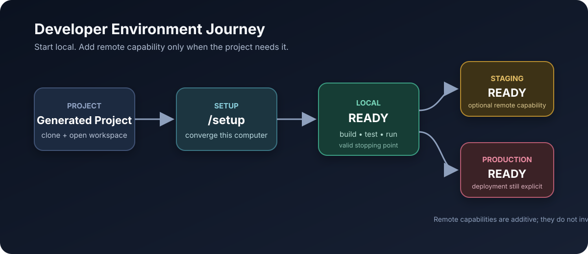
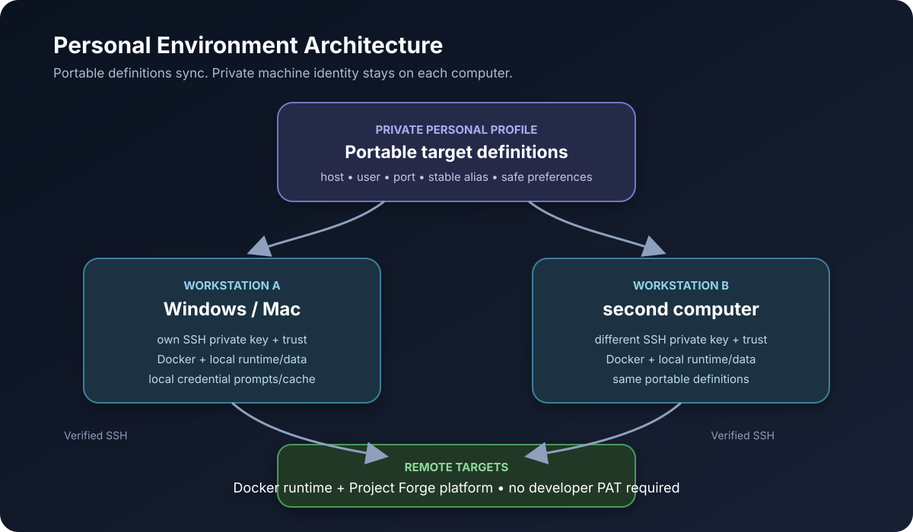
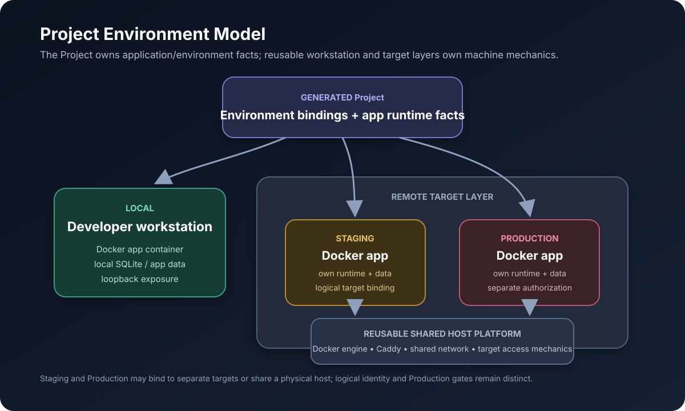

# Developer Environments

Status: **CORE WORKSTATION/TARGET MECHANICS IMPLEMENTED; AUTOMATED HOST PACKAGE PREPARATION REMAINS INCREMENTAL**

This document is the canonical developer-environment model for Project Forge. It describes the developer-facing progression from a generated repository to local development, optional Staging/Production capability, additional workstations, and additional remote boxes.

The happy path intentionally hides Bootstrap/package/control-plane plumbing. Developers should see meaningful milestones and actionable setup, while the underlying repositories retain exact provenance and safety evidence.

## Developer journey



The normal progression is:

```text
generated Project repository
→ clone/open workspace
→ /setup
→ LOCAL READY
→ optional remote onboarding
→ STAGING READY
→ optional Production onboarding
→ PRODUCTION READY
```

Local readiness is a valid complete developer state. Staging and Production are progressive capabilities, not prerequisites for coding.

## One setup front door

The generated repository provides deterministic OS launchers:

```text
Windows  .\scripts\setup.ps1
macOS    ./scripts/setup.sh
```

The normal conversational entry point is:

```text
/setup
```

`/setup` explains the current state/options and invokes the correct repository-local setup launcher. Direct script invocation remains the non-AI/automation fallback.

The first local success target is `LOCAL WORKSPACE READY`. Remote access must not block it unless the Project explicitly requires a remote dependency for local development.

For remote onboarding, conversational `/setup remote` or `/setup <environment>` should consume one deterministic read-only setup state machine rather than manually reconstructing low-level steps:

```text
project-forge-deploy environment setup status <target> --json
project-forge-deploy environment setup plan <target> --json
```

When target access and the host platform are ready, proof context can be included without performing a write:

```text
project-forge-deploy environment setup plan <target> \
  --owner-repo <owner/repo> \
  --environment <logical-environment> \
  --json
```

Add `--production` only when that logical environment is Production-class. Setup status/plan never authorizes a write; they report the existing authorization phrase and exact next deterministic operation when a write is required.

Readiness is deliberately separated into:

```text
WORKSPACE READY
TARGET DEFINITION READY
TARGET ACCESS READY
HOST PLATFORM READY
DEPLOYMENT PATH PROVEN
APPLICATION DEPLOYED
```

The last state is not part of setup. A successful disposable proof does not deploy the Project application.

## Progress and next action

Use `/progress` to answer what is complete, what is blocked/deferred, who owns the next action, and local/Staging/Production capability state.

Use `/next-step` for one recommended next action.

Progress uses milestone states rather than percentages. Internal Bootstrap/package/generator phases are not developer milestones unless an internal failure becomes the actionable blocker.

## Personal environment architecture



Each developer owns an independent portable profile. Two developers may describe the same physical target, but neither depends on the other's profile or workstation credentials.

### Private personal Project Forge profile

The standard personal repository is:

```text
<authenticated-github-user>/project-forge-profile
```

It must be private. The canonical portable file is:

```text
project-forge-profile.json
```

It contains only sanitized target definitions:

- logical target name;
- target OS profile;
- stable DNS/mDNS hostname;
- SSH user and port;
- stable SSH host alias/identity name.

It does **not** contain SSH private keys, passwords/passphrases, PATs/tokens, `known_hosts` contents, machine-specific credential paths, temporary IP overrides, local runtime/data, or readiness claims.

Direct deterministic commands are available beneath `/setup`:

```text
project-forge-deploy environment profile status
project-forge-deploy environment profile ensure
project-forge-deploy environment profile sync --apply
project-forge-deploy environment profile publish
```

`profile ensure` creates/initializes only the authenticated developer's exact private `project-forge-profile` repository and requires:

```text
[PERSONAL PROFILE WRITE]
```

An empty profile with `targets: []` is valid. A local-only developer never needs a remote target merely to have a portable workstation profile.

`profile sync` fetches and validates the GitHub profile, updates the validated local cache, and with `--apply` creates only missing non-conflicting local target definitions. Existing differing local definitions are never overwritten.

Portable identity deliberately excludes workstation-local `addressOverride`, identity-file, and trust-file state. A separately verified temporary IP therefore does not make the same portable host definition a different target.

`profile publish` merges new non-conflicting local target definitions into the private profile and fails on conflicts rather than silently replacing remote definitions.

### Workstation-local state

Each workstation owns its own:

- SSH private key/identity;
- host trust;
- credential-manager entries when explicitly chosen;
- validated profile cache/last-known-good snapshot;
- local Docker/runtime state;
- repository-scoped developer-mode evidence.

Private SSH keys are never synchronized between computers. A Mark Windows key, Mark Mac key, Kyle Mac key, and Daniel Windows key are distinct identities even when they can reach the same remote server.

The deterministic doctor resolves and reports the actual SSH executable selected from the workstation environment; all Deployment Kit SSH operations use that resolved toolchain rather than asking the developer to mix shell-specific SSH clients manually.

## Home Lab remote onboarding

The implemented Home Lab path is password-assisted bootstrap followed by normal strict key-only operation.

Preview:

```text
project-forge-deploy environment home-lab plan <target> \
  --host-name <stable-hostname> \
  --user <ssh-user>
```

Bootstrap:

```text
project-forge-deploy environment home-lab bootstrap <target> \
  --host-name <stable-hostname> \
  --user <ssh-user>
```

The password prompt is owned by local OpenSSH. The password is never pasted into chat, passed as a command argument, or persisted by Project Forge.

The flow is:

```text
create/reuse target definition
→ create/reuse this workstation's key
→ first-use host pinning in target-specific trust file when needed
→ local OpenSSH password prompt
→ append public key idempotently to authorized_keys
→ strict key-only verification
→ TARGET ACCESS READY
```

The default Home Lab key is unencrypted for convenience. `--protect-key-with-passphrase` delegates a key passphrase prompt to `ssh-keygen`; protected keys must be available to the SSH agent for later non-interactive verification.

A changed previously pinned host key remains a blocker and requires explicit trust rotation. Existing stricter console-verified trust is preserved during migration rather than weakened.

## Docker and host preparation

Docker is a workstation/target capability, not something every Project should reinstall.

### Developer workstation

The first Project on a computer may install/verify required local tools and Docker through the generated setup contract. Later Projects reuse the ready workstation.

### Remote Ubuntu target

Target access can be established from the local workstation, but full automatic Ubuntu package preparation is still an incremental capability. The desired host progression remains:

```text
Ubuntu/sudo verification
→ Docker Engine/Compose if missing
→ required Project Forge host prerequisites
→ Project Forge shared host platform
→ platform doctor
→ TARGET READY
```

The current platform doctor/install contract still requires host prerequisites to exist before shared-platform installation. Until a reviewed host-package bootstrap is added, `/setup remote` reports missing host packages as an actionable preparation gap rather than pretending they were installed. The deterministic setup plan keeps this as a distinct `HOST PLATFORM READY` blocker.

Healthy existing Docker/Project Forge installations are adopted/verified, not recreated. Ambiguous/incompatible existing state fails closed rather than being overwritten.

## GitHub/GHCR credentials stay local

A developer should not need to SSH to Staging/Production and enter a GitHub PAT.

The implemented workstation-mediated artifact path is:

```text
local GitHub/GHCR authentication when needed
→ acquire/build exact immutable image locally
→ preserve registry RepoDigest as declared/release identity
→ resolve local Docker config/image ID
→ stream Docker image over verified SSH
→ remote docker load
→ verify the same config/image ID remotely
→ deploy/health-check by that verified loaded image ID
```

Docker `save`/`load` does not guarantee that a registry RepoDigest remains inspectable as a remote RepoDigest after load. Project Forge therefore uses two explicit identities: registry digest for reviewed release provenance, and Docker config/image ID for transport verification and the preloaded runtime reference.

Remote Home Lab boxes therefore do not need a developer's persistent GitHub PAT for the normal workstation-mediated deployment path.

Application deployment selects this with:

```text
--image-source workstation
```

The legacy `--image-source remote-registry` path remains available for explicit target-side registry use.

A credential needed to acquire a private image is entered only through the local Docker/GitHub credential boundary. Never paste it into chat or put it on a command line.

If the exact immutable image is already cached locally, registry authentication is not required merely to transfer it to the remote target.

## Project environment model



The Project owns project-specific facts such as environment identities/roles, placement, target binding, application image, runtime/health contract, persistence, routes/exposure, and Production classification/authorization.

The reusable workstation/target layer owns machine mechanics. A Project references targets; it does not own or duplicate a developer's private credentials.

## New workstation

A developer normally starts from any generated Project:

```text
clone repository
→ open generated VS Code workspace
→ /setup
```

`/setup` detects whether this is a fresh or already-prepared workstation and converges only missing safe capabilities.

When GitHub is reachable, personal profile sync supplies portable target definitions. The new workstation still creates its own SSH identity/trust. Remote setup is optional and can be deferred until needed.

## New remote box

Adding a new remote target is a workstation-driven onboarding operation, not a Project implementation step:

```text
add/import portable target definition
→ Home Lab or Strict workstation SSH onboarding
→ verify/prepare Docker host prerequisites
→ verify/install Project Forge shared platform
→ TARGET READY
```

Once ready, multiple Projects can bind logical environments to that target without repeating host bootstrap.

## Portable export/import fallback

Normal portability is the developer's private `project-forge-profile`. A sanitized environment bundle is also implemented for explicit sharing/offline bootstrap:

```text
project-forge-deploy environment profile export --target <name> --output project-forge-environment-bundle.json
project-forge-deploy environment profile preview-import project-forge-environment-bundle.json
project-forge-deploy environment profile import project-forge-environment-bundle.json
```

Export/import is copy-by-value. Importing another developer's target definition creates an independent personal copy; later changes do not silently propagate across users.

A portable bundle contains only non-secret definition fields. Import never transfers readiness, private keys, passwords, trust contents, credential paths, or IP overrides and never overwrites a conflicting existing target.

## Last-known-good/offline behavior

Validated profile state is cached under the user-scoped Project Forge home:

```text
~/.project-forge/profile/current/project-forge-profile.json
~/.project-forge/profile/last-known-good/project-forge-profile.json
~/.project-forge/profile/sync-state.json
```

A valid GitHub fetch updates both current and last-known-good snapshots. An invalid/unavailable remote profile never overwrites last-known-good state.

When GitHub cannot be reached, profile sync can use the validated last-known-good profile so local work and previously established target definitions remain usable. Remote operations still require independent machine-specific access/trust verification.

## Migration for existing developers

Existing developer environments should migrate fully to this model rather than remain permanently dual-mode.

The migration contract is:

```text
inventory existing workstation/targets
→ ensure private personal project-forge-profile + validated cache
→ adopt healthy existing Docker/SSH/trust where valid
→ establish workstation-mediated artifact delivery
→ prove a non-Production environment end-to-end
→ verify Production access/readiness without deploying when Production is configured
→ remove/archive superseded legacy configuration only after verification
```

Migration must not reinstall healthy Docker, rotate valid SSH identities merely for consistency, redeploy unrelated applications, reset data, or weaken stricter existing trust.

Server-side GHCR credentials/PATs are removed only after proving that no remaining deployment path depends on them. Existing remote application containers/data remain intact while the access/deployment mechanism changes.

After migration, the new profile/workstation model is authoritative. Legacy configuration may be retained temporarily only as explicitly inactive migration backup, not as a second active source of truth.

## Progressive readiness examples

All of these are valid states:

```text
Local READY
Staging NOT CONFIGURED
Production NOT CONFIGURED
```

```text
Local READY
Staging READY
Production NOT AUTHORIZED
```

```text
Local READY
Staging READY
Production READY (access/readiness only)
```

Production readiness never implies Production deployment authorization.

## Developer-facing commands

The intended small human surface is:

```text
/setup
/setup local
/setup remote
/setup <environment>
/progress
/next-step
/deployment-readiness <environment>
/deploy <environment>
```

`/setup` is the single setup front door; the local/remote/environment forms select its scope rather than introducing a separate developer-environment command. `project-forge-deploy environment ...` commands are deterministic implementation/fallback surfaces and can be invoked directly when desired.


### Deployment evidence within the existing readiness and deploy workflow

When a Project has an existing successful supported private-image publisher
run, a Builder can request a deployment status/evidence handoff through the
normal readiness or deployment conversation. Use the installed Deployment
Kit's existing `app inventory` command in its explicitly scoped evidence
mode, if the installed version supports the options. Resolve the exact
Project repository, application slug, logical environment, verified named
target and existing publisher run from Project-owned records; do not guess
or default to Production. A first deployment without an actual publisher
run remains a prerequisite gap, not a reason to publish for diagnostics.

Example for an already resolved remote target (replace illustrative scope
with the actual Project evidence):

```sh
python3 tools/project-forge-deployment/project-forge-deploy.py app inventory target --json \
  --owner-repo owner/project --app-slug app --environment demo \
  --publication-run 123 --partial
```

Ordinary inventory without those options is unchanged. The scoped path
returns the versioned deployment evidence handoff, not the full host
inventory or another application's data. It uses existing authenticated
GitHub CLI access, then existing read-only Kit inventory for the named
target. For the exact private user-owned image, optional
`--collect-registry` verifies workstation Docker Buildx raw manifest bytes
and existing package metadata without logging in, pulling, pushing or
accessing new credentials. Unsupported or expired/inaccessible
publisher evidence fails closed; optional stage failure with
`--partial` preserves independent evidence and exits 2.
Do not infer remote registry access from a workstation result.

An explicit `--endpoint` records an HTTP(S) origin as a reported selection,
not verified route access. Reuse existing attributed, release-scoped human
report documents with repeatable `--human-report PATH`; they remain
unverified claims. An optional merged PR reference requires all three
`--pr NUMBER --pr-head SHA --pr-base SHA` and the merge commit must match
the selected release. A private signed-out PR page error is not evidence
that an authenticated exact comparison is unavailable.

Use `--output PATH` only to create a new explicit local handoff; it never
overwrites an earlier export. Retain original evidence separately, within
the Project's authorized access boundary. The JSON includes original
observations and a final-time lifecycle assessment. Publisher receipt
consistency and registry manifest/config digest equality are not signed
application provenance, actual running image identity or approval. Missing
target-specific compatibility, backup/recovery, approved desired state,
formal acceptance and shared-service identity remain unknown. Evidence
export does not import to a dashboard. Use the existing deployment and
acceptance workflow for any separately authorized write; no new approval,
signer, host trust, release or Production execution path is introduced.
